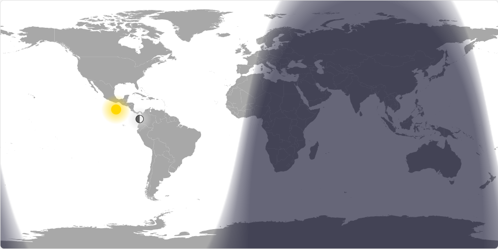

# Day/Night World Map

A real-time visualization of daylight, darkness, and twilight across Earth, featuring solar and lunar positioning, local astronomical information, and a dedicated dashboard optimized for e-ink displays.

Based on [lanrat/day-night-map](https://github.com/lanrat/day-night-map), with additional display modes and dashboard functionality.

**Live application:** https://p-i-c-o.github.io/day-night-map/



## Features

- Real-time visualization of day and night across Earth
- Smooth twilight gradients representing dawn and dusk
- Solar and lunar position markers
- Moon phase visualization and illumination calculations
- Sunrise, sunset, solar noon, and golden hour information
- Moonrise and moonset calculations
- Location selection through URL parameters or browser geolocation
- Optional location marker
- Configurable timezone using IANA timezone identifiers
- Grayscale rendering optimized for e-ink displays
- Equirectangular and Mercator projection options
- Responsive layouts for desktop, mobile, and embedded displays
- Static astronomical snapshots using Unix timestamps
- Automatic map updates every minute

### Display Modes

The application supports three viewing modes.

| Mode | Parameter | Description |
|---|---|---|
| Normal | None | Full interface with astronomical information |
| Minimal | `minimal` | Full-screen map with compact information panels |
| Map Only | `maponly` | E-ink dashboard with date, world map, and solar information |

All modes support grayscale rendering, location markers, timezone configuration, and astronomical positioning options.

## Usage

### Normal Mode

The original interface, displaying the world map alongside solar and lunar information.

https://p-i-c-o.github.io/day-night-map/

### Minimal Mode

An optimized full-screen layout with compact information panels.

https://p-i-c-o.github.io/day-night-map/?minimal

### Map Only Dashboard

A dedicated dashboard originally designed for the Kobo Libra 2 and LaraPaper.

https://p-i-c-o.github.io/day-night-map/?maponly&grayscale

Features:

- Large date header formatted as `YY/MM/DD`
- Muted grey "Day / Night" heading
- Centered world map preserving its 2:1 aspect ratio
- Sunrise and sunset times
- Calculated daylight duration
- Minimalist typography using Inter
- High-contrast grayscale visualization
- Responsive layout without unnecessary information panels

The dashboard retains the sun and moon position markers while omitting the original moon phase and detailed astronomical information panels.

The sunrise, sunset, and daylight statistics require valid geographic coordinates.

**Example with Geneva coordinates:**

https://p-i-c-o.github.io/day-night-map/?maponly&grayscale&showloc&lat=46.2044&lon=6.1432&timezone=Europe/Zurich

## URL Parameters

Parameters can be combined using standard query strings (`?`) or URL fragments (`#`).

### Display

| Parameter | Description |
|---|---|
| `minimal` | Enable the original minimal layout |
| `maponly` | Enable the custom dashboard layout |
| `grayscale` | Enable grayscale rendering |
| `hour24` | Use 24-hour time formatting |
| `projection=mercator` | Select Mercator projection |
| `projection=equirectangular` | Select the default projection |

### Location

| Parameter | Description |
|---|---|
| `lat=<value>` | Latitude, from -90 to 90 |
| `lon=<value>` | Longitude, from -180 to 180 |
| `timezone=<value>` | IANA timezone identifier |
| `showloc` | Display the configured location on the map |

If geographic coordinates are not supplied, the application attempts to use the browser's Geolocation API.

If location detection fails, location-dependent information may be unavailable.

The timezone parameter controls displayed times but does not change the geographic location.

### Celestial Markers

| Parameter | Description |
|---|---|
| `nosun` | Hide the sun position marker |
| `nomoon` | Hide the moon position marker |

These parameters only control the corresponding visual markers and legends. They do not disable the underlying astronomical calculations.

### Time

| Parameter | Description |
|---|---|
| `timestamp=<value>` | Render a specific moment using a Unix timestamp |

Timestamps may be supplied in seconds or milliseconds.

When a timestamp is provided, the visualization remains static instead of automatically refreshing.

### Examples

**Minimal grayscale display**

`?minimal&grayscale`

**Map Only dashboard**

`?maponly&grayscale`

**Map Only with location**

`?maponly&grayscale&showloc&lat=46.2044&lon=6.1432`

**Map Only without celestial markers**

`?maponly&grayscale&nosun&nomoon`

**Map Only using London time**

`?maponly&grayscale&lat=51.5074&lon=-0.1278&timezone=Europe/London`

**Tokyo with 24-hour time**

`?lat=35.6762&lon=139.6503&timezone=Asia/Tokyo&hour24`

**Specific historical timestamp**

`?timestamp=1672531200`

**Mercator projection**

`?projection=mercator`

## LaraPaper Integration

The Map Only dashboard is designed to work as an embedded webpage inside a LaraPaper/TRMNL plugin.

The recommended integration uses an iframe pointing to this fork's GitHub Pages deployment.

### Liquid Template

```html
<div class="view view--{{ size }}">
  <style>
    .dnm-view {
      width: 100%;
      height: 100%;
      min-height: 0;
      overflow: hidden;
      position: relative;
    }

    .dnm-iframe {
      display: block;
      position: absolute;
      inset: 0;
      width: 100%;
      height: 100%;
      border: none;
    }
  </style>

  
  
  

  <div class="dnm-view">
    <iframe
      class="dnm-iframe image-dither"
      data-pixel-perfect="true"
      title="Day/night world map"
      scrolling="no"
      loading="eager"
      src="https://p-i-c-o.github.io/day-night-map/?maponly&grayscale&timezone={{ dnm_tz | url_encode }}&lat={{ dnm_lat }}&lon={{ dnm_lon }}&{{ trmnl.plugin_settings.custom_fields_values.showloc }}&{{ trmnl.plugin_settings.custom_fields_values.nosun }}&{{ trmnl.plugin_settings.custom_fields_values.nomoon }}&{{ trmnl.plugin_settings.custom_fields_values.hour24 }}">
    </iframe>
  </div>
</div>
```

The example defaults to Geneva coordinates and the `Europe/Zurich` timezone when no values are provided.

These defaults should be changed or removed when deploying for other locations.

### Rendering Considerations

LaraPaper captures the rendered plugin as an image.

Because the plugin loads an external webpage, rendering depends on:

1. Network access to GitHub Pages
2. Successful loading of the map's JavaScript and CSS
3. Successful loading of SunCalc
4. Valid geographic coordinates
5. Sufficient time for JavaScript initialization before screenshot capture

A map can appear even when location-dependent data has not loaded.

If the dashboard displays `--:--`, verify that the date header and solar statistics elements exist and that JavaScript execution completes successfully.

### Caching

GitHub Pages and the LaraPaper screenshot renderer may cache resources independently.

To invalidate the embedded page URL, add or increment a version parameter:

`?maponly&grayscale&v=4`

If JavaScript or CSS remains cached, version the asset references inside `index.html`:

```html
<link rel="stylesheet" href="styles.css?v=4">
<script src="script.js?v=4"></script>
```

Increment these values following relevant changes.

For consistent results, ensure that the deployed GitHub Pages version and the LaraPaper plugin are using compatible parameters.

## Technical Architecture

The application is a static website requiring no dedicated backend.

### Components

| File | Purpose |
|---|---|
| `index.html` | Page structure, map container, information panels, dashboard |
| `styles.css` | Responsive layouts, display modes, grayscale styling |
| `script.js` | Astronomical calculations, canvas rendering, dashboard updates |
| `BlankMap-Equirectangular.svg` | Base world map image |

The application can be hosted using GitHub Pages or any static web server.

### Rendering Pipeline

The map combines a static SVG world map with an HTML5 Canvas overlay.

1. The browser loads the base SVG.
2. JavaScript determines the requested date and time.
3. Solar and lunar positions are calculated.
4. Solar elevation is evaluated across the map.
5. A semi-transparent day/night overlay is rendered.
6. Optional solar, lunar, and geographic location markers are drawn.
7. Information panels and dashboard statistics are updated.

The overlay is generated using pixel-level canvas operations.

### Astronomical Calculations

The application integrates [SunCalc](https://github.com/mourner/suncalc) for:

- Sunrise and sunset
- Solar elevation
- Solar noon
- Golden hour periods
- Moonrise and moonset
- Moon phase and illumination
- Lunar distance

Additional custom calculations determine solar and lunar geographic positions.

These calculations are suitable for visualization and general astronomical information, but should not be treated as precision ephemeris data for scientific or navigational purposes.

### Twilight Rendering

The visualization represents the transition between daylight and darkness using solar elevation.

The rendering distinguishes regions around:

- Daylight
- Civil twilight
- Nautical twilight
- Astronomical twilight
- Deep night

Grayscale mode converts the representation into shades suitable for monochrome and e-ink displays.

Night shading is applied using transparency rather than simply replacing the map with solid colors.

### Location and Timezone Handling

Location and timezone are separate settings.

**Coordinates** determine local astronomical events and the optional location marker.

**Timezone** determines how dates and times are formatted.

For example:

`?lat=46.2044&lon=6.1432&timezone=Europe/Zurich`

If coordinates are absent, the application attempts browser geolocation.

If the timezone is absent, the browser's local timezone is used.

### Map Projections

The default equirectangular projection maps longitude and latitude linearly onto the world map.

The application also provides a Mercator projection option.

The included SVG is equirectangular, so the default projection is recommended for correct alignment.

Switching the canvas coordinate projection does not automatically transform the underlying SVG artwork.

## E-Ink Optimization

The Map Only dashboard was developed with e-ink devices in mind, particularly the Kobo Libra 2.

Design considerations include:

- Grayscale rendering
- Strong visual contrast
- Limited decorative elements
- Large, readable typography
- Fixed aspect ratio for geographic accuracy
- Minimal information density
- Static screenshot compatibility

The application itself does not control the physical e-ink refresh process.

Display refresh behavior, ghosting, dithering, and screenshot generation depend on the client device and rendering software.

## Development

### Local Testing

Clone the repository:

```bash
git clone https://github.com/p-i-c-o/day-night-map.git
cd day-night-map
```

Start a local HTTP server:

```bash
python3 -m http.server 8000
```

Open:

http://localhost:8000/

Or test the dashboard directly:

http://localhost:8000/?maponly&grayscale&showloc&lat=46.2044&lon=6.1432

The Python server serves files from the current directory and does not modify project files. By default, it listens on all network interfaces, so use `--bind 127.0.0.1` if local-only access is desired.

### GitHub Pages Deployment

This fork is hosted at:

https://p-i-c-o.github.io/day-night-map/

GitHub Pages can deploy directly from the repository's default branch.

Configuration:

- **Settings → Pages**
- Source: Deploy from a branch
- Branch: `main`
- Directory: `/ (root)`

After committing changes, GitHub Pages may require some time before the deployment becomes available.

### Development Guidelines

When adding functionality:

- Preserve the behavior of existing URL parameters.
- Keep normal and minimal modes backward-compatible.
- Restrict dashboard-specific CSS to `.map-only-mode`.
- Avoid duplicating HTML element IDs.
- Keep geographic calculations independent of display formatting.
- Preserve the existing canvas rendering pipeline.
- Ensure the SVG and canvas remain aligned.
- Test location-dependent calculations with explicit coordinates.
- Test both color and grayscale rendering.
- Verify rendering at different viewport aspect ratios.

## Credits

Original project: [lanrat/day-night-map](https://github.com/lanrat/day-night-map)

Fork and additional dashboard functionality: [p-i-c-o/day-night-map](https://github.com/p-i-c-o/day-night-map)

Astronomical library: [SunCalc](https://github.com/mourner/suncalc)

Inspired by the [Time and Date Day and Night World Map](https://www.timeanddate.com/worldclock/sunearth.html).

See the repository's license for applicable licensing terms.
